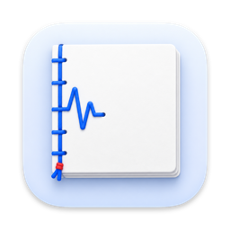
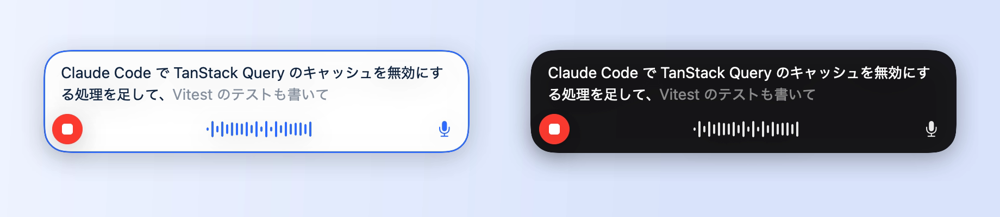
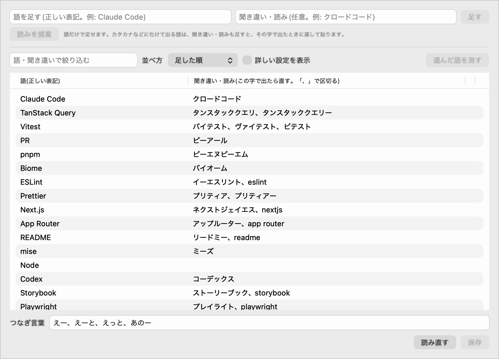
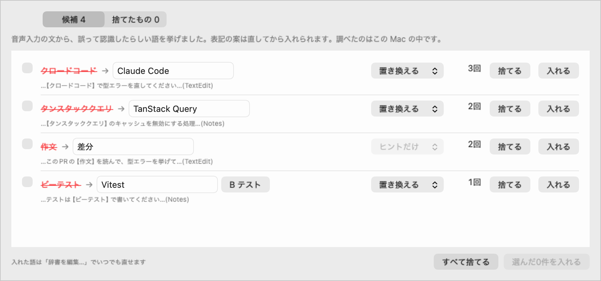
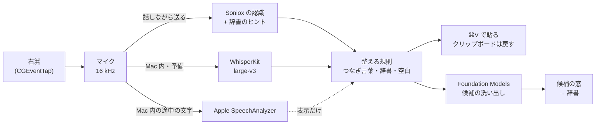

<p align="center"></p>

# Tsuzuri

Mac のメニューバーに常駐する、日本語の音声入力アプリ。キーを押して話すと、いま使っているアプリの入力欄に文字を打ち込む。話している間は途中の文字が出て、技術用語は自分の辞書で表記をそろえ、辞書に足すべき語は Mac の中の LLM が挙げる。

[](https://github.com/GentaAmeku/Tsuzuri/actions/workflows/ci.yml)
[](LICENSE)
[](#入れ方)
[](Package.swift)

[English](README.md) | 日本語

日本語の音声入力は、日本語は得意でも、開発者が口にする語は苦手だ。*Claude Code* はクロードコードに、*TanStack Query* はタンスタッククエリに、*Vitest* は B テストになり、コーディングエージェントへの指示は送る前に毎回直すことになる。Tsuzuri は、Claude Code や Codex への指示・Slack・文書を一日中声で書くために作ったアプリ。認識は Soniox の話しながらの認識が主で、Mac の中の WhisperKit が予備になる。辞書は認識にヒントとして渡し、それでも誤った語は貼る前に直す。


*録音中の表示(本物の窓を写したもの)。新しく届いた字は浮かび上がり、カードは下の辺を動かさずに上へ伸びる。*

## できること

### 押して話すと、いま使っているアプリに打ち込む

右⌘を短く押すと録音を始め、もう一度押すと止める。長く押せば、押している間だけ録る。表示は押した瞬間に出て、話している間は途中の文字が流れ、止めると元のアプリに ⌘V で貼る(クリップボードは借りて、0.3秒後に元へ戻す)。録音中に Return を押すと、貼ったあとにそのまま送信する(Slack・チャット・エージェントへの指示)。Esc で取り消し、⌃⌥⌘V で直前の文字をもう一度貼る。録音キー・操作の方式(短押し・長押し・両方)・長押しの秒数は設定で変えられる。



*テーマは青と白(既定)と黒の2つ。まだ変わりうる文字は薄く出す。*

### 技術用語を、自分が書く表記で出す

辞書には2つの役目がある。辞書の語は、認識にヒントとして渡す(Soniox の context terms・Whisper のプロンプト・Apple の contextualStrings)。渡すのは、いつも渡す語・2週間以内に足した語・よく使う語の順に選んだ語。もう1つは置き換えで、聞き違いの字を登録した語は、認識のあとに直す(クロードコード → Claude Code)。置き換えは字の種類で語の境目を決め、語の丸ごとにだけ当てるので、長いカタカナ語の一部は書き換えない。漢字の聞き違いは同音異義語が多いので置き換えない。同じ規則で、つなぎ言葉(えーと・あのー)を消し、日本語と英字のあいだに半角スペースを入れる。この規則は話している途中の文字にもかけるので、見えている文字と貼る文字がそろう。



語を足すのは1行。打って Return を押せば、その場で保存する。「読みを提案」を押すと、Mac の中のモデルが、その語が化けそうなカタカナの読みを挙げる。

### 辞書に足すべき語を挙げる

貼るたびに、裏で文を見て、誤って認識したらしい語(辞書の語に読みが近いカタカナ、カタカナに化けた技術用語)を拾い、Mac の中の Apple Foundation Models に、本来の表記の案を出させる。勝手には辞書に入れない。候補は窓にたまり、入れるものを選び、表記を直し、置き換えるかヒントだけにするかを決める。捨てた組は二度出さない。



### 通信なしでも使える

メニューで「Mac 内」を選ぶと、何も外へ送らない。止めたあとに WhisperKit(Whisper large-v3、626MB)が文字にし、話している間の途中の文字は Apple の SpeechAnalyzer が出す。Soniox に2秒でつながらない・確定が3秒を超えたときは、手元に残した録音を Mac の中で文字にして貼り、その後5分は Mac 内で認識する。メニューには今月の Soniox の使用時間と推定の代金を出し、直前の録音の認識し直しもできる。

## 仕組み



コードは Xcode のプロジェクトを持たない Swift のパッケージ。`TsuzuriCore` は副作用の無い処理(録音キーの状態の移り変わり・途中の文字の組み立て・整える規則と置き換え・ヒントの選び方・候補の拾い方と除き方)で、テスト(swift-testing で134件)の中心。`TsuzuriEngines` は外とのやり取り(Soniox の WebSocket・WhisperKit・SpeechAnalyzer・Foundation Models・マイク・キーチェーン)。`TsuzuriApp` は SwiftUI と AppKit のメニューバーのアプリで、`tsuzuri-eval` は判断のたびに測るためのコマンドラインの道具。

## 測って決めた

アプリを書く前に、自分の声で40文(コーディングエージェントへの指示・Slack・技術用語の多い文書の文)を録り、4つの認識に流した。アプリの選択はこの表から決めた。

| 認識 | 辞書のヒント | 文字誤り率 | 用語正答率 | 止めてからの待ち時間(中央値) | メモリ |
| --- | --- | ---: | ---: | ---: | ---: |
| Soniox(クラウド) | あり | **5.2%** | **85.5%** | **0.19秒** | — |
| WhisperKit large-v3 | あり | 10.9% | 59.7% | 2.08秒 | 約0.2GB |
| Qwen3-ASR 1.7B | あり | 12.6% | 59.7% | 0.85秒 | 約7.2GB |
| Apple DictationTranscriber | あり | 20.7% | 33.9% | 0.34秒 | — |

ヒントはどの認識でも最も効いたので、主は Soniox+ヒント、Mac 内は WhisperKit にした。Soniox に整える規則と、語ごとのふつうの読みを置き換え元にした辞書を足すと、文字誤り率は3.1%・用語正答率は91.9%。誤りを見て足した2語を加えると2.3%・95.2%(この2語は同じ40文から見つけたので甘めの数字)。

候補の洗い出しも同じように、保存した認識結果160文で測った。誤って認識した語の54%を挙げ、外れの候補は10文あたり2.1件。Mac の中の小さなモデルは製品名をほとんど知らず、表記の案が当たるのは4分の1ほど。だから候補は自動では入れず、表記を直せる形で見せる。

## 作り方

Tsuzuri は [Claude Code](https://www.anthropic.com/claude-code) との会話で設計し、作った。段階は5つ(測る・最小のアプリ・辞書と予備・候補の洗い出し・仕上げ)。どの段階も設計書から始め、設計書に照らして終えた。迷った判断(どの認識にするか・候補の洗い出しをどこまで厳しくするか・録音中の表示の4案のどれか・アプリのアイコン)は、比較表と画面のイメージを載せた質問票で決めた。設計書と質問票は、もう1つの自作の [AI Handout Studio](https://github.com/GentaAmeku/ai-handout-studio) で作っている。アイコンの絵は Codex の画像生成で描いた。もとの着想は、クウキデザインの動画で紹介された Soniox+辞書の音声入力の仕組みで、Tsuzuri はそれを日本語の技術の仕事向けに自分で作り直したもの。

## 触れるもの

- **権限:** マイクと、アクセシビリティ(録音キーの検知に使う `CGEventTap`・録音中の Esc と Return・⌘V の貼り付けのため)。パスワードの欄などで安全な入力が働いている間は録音しない
- **通信:** Soniox のときは、録音中の音声を Soniox へ送る。Mac 内のときは何も送らない。Soniox の API キーはキーチェーン(サービス名 `Tsuzuri.Soniox`)に置き、ファイルには書かない
- **クリップボード:** 貼るために借り、0.3秒後に元へ戻す。その間に別のものをコピーしたとき、パスワード管理のアプリが隠す印を付けた中身のときは戻さない
- **ファイル:** 辞書・候補・直近100件の文字・月ごとの Soniox の使用量・(既定で)7日分の音声を `~/Library/Application Support/Tsuzuri` に置く。Mac 内のモデルは `~/Library/Caches/Tsuzuri/models`。アプリが自分でモデルを取得することはない

## 入れ方

Apple シリコンの Mac(macOS 26)、Xcode 26(Swift 6.2)、キーチェーンにある *Apple Development* の証明書が要る。マイクとアクセシビリティの許可はアプリの署名に結び付くので、ビルドのスクリプトが署名する。候補の洗い出しと読みの提案には Apple Intelligence を入れておく。[Soniox](https://soniox.com) の API キーは任意で、無ければ Mac 内で使う。

```bash
git clone https://github.com/GentaAmeku/Tsuzuri.git && cd Tsuzuri
swift run tsuzuri-eval fetch-model --apple   # Mac 内のモデル: WhisperKit(約600MB)と Apple の日本語のモデル
swift run tsuzuri-eval set-key               # 任意: Soniox の API キーをキーチェーンに置く
scripts/build-app-bundle.sh --install        # ビルドして署名し、/Applications に Tsuzuri.app を置く
```

初めて起動すると設定の窓が開くので、マイクとアクセシビリティを許可する(Soniox の API キーは、`set-key` の代わりにここへ貼ってもよい)。あとは右⌘を押して話す。

| キー | すること |
| --- | --- |
| 右⌘を短く押す | 録音を始める。もう一度押すと止めて貼る |
| 右⌘を長く押す(0.5秒以上) | 押している間だけ録り、離すと貼る |
| 右⌘と一緒にほかのキー(0.2秒以内) | ⌘C などの同時押しとみなし、何もしない |
| 録音中に Esc | 取り消す |
| 録音中に Return | 止めて貼ったあとに Return を送る |
| ⌃⌥⌘V | 直前の文字をもう一度貼る |

## 知っておくこと

- 日本語(と英語の技術用語)のためのアプリ。画面の文言は日本語だけ
- macOS 26 と Apple シリコンだけ。ビルド済み・公証済みの配布は無いので、自分でビルドして署名する
- Soniox は有料の API(音声1時間あたり約0.12ドルと、ヒントの文字の代金)。メニューの代金は目安なので、正確な額は Soniox の画面で確かめる
- Mac 内のときは、止めてから貼るまで約2秒かかる。途中の文字は貼る文字と別の認識で出すので、少し違うことがある
- 自分用の道具なので、初期値・時間・最初の辞書は作者の仕事に合わせてある

## もっと読む

- 段階ごとの作り方と、評価用の CLI の使い方: [docs/development.ja.md](docs/development.ja.md)
- `swift build` と `swift test` で全体を確かめる。`Tools/Qwen3Eval` は評価だけに使う別のパッケージ

## ライセンス

[MIT](LICENSE)。[WhisperKit](https://github.com/argmaxinc/WhisperKit)(MIT)・[KeyboardShortcuts](https://github.com/sindresorhus/KeyboardShortcuts)(MIT)・[swift-argument-parser](https://github.com/apple/swift-argument-parser)(Apache 2.0)を使っている。
